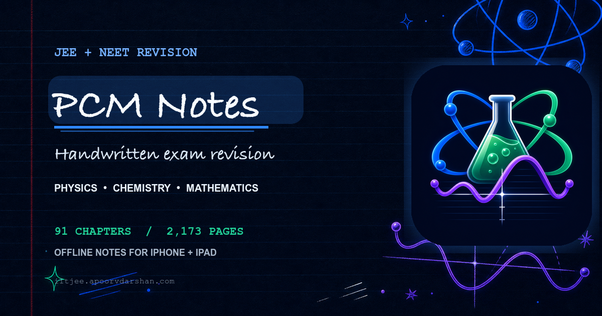

<p align="center">
  
</p>

<h1 align="center">PCM Notes</h1>

<p align="center"><em>Handwritten exam revision.</em></p>

<p align="center">
  
  
  
  
  
</p>

---

**PCM Notes** turns a large handwritten Physics, Chemistry, and Mathematics archive into a focused native reader for iPhone and iPad. Find a chapter, open its complete PDF, and keep revising without waiting for a connection.

Physics and Chemistry support JEE and NEET revision. Mathematics is organised for JEE Main and Advanced. Biology is not included.

> Less hunting. More revising.

<p align="center">
  
</p>

## ✏️ Inside the notebook

| Subject | Chapters | Pages | Revision focus |
|---------|---------:|------:|----------------|
| ⚛️ Physics | 23 | 539 | JEE + NEET |
| 🧪 Chemistry | 37 | 993 | JEE + NEET |
| 📐 Mathematics | 31 | 641 | JEE Main + Advanced |
| **Total** | **91** | **2,173** | Complete handwritten archive |

## ✨ Features

- **Fully offline archive** — all 91 chapter PDFs are bundled with the app; reading and zooming never depend on the website.
- **Full-screen focus reader** — chapters open directly from the list into a clean, distraction-free PDF view.
- **Reading progress** — each chapter remembers the last page and offers one-tap resume from its subject index.
- **Fast navigation** — page slider, previous/next controls, native pinch-to-zoom, and local PDF sharing.
- **iPad two-page spreads** — switch between continuous reading and a book-like two-page layout.
- **Chapter search** — filter by chapter title or number inside every subject.
- **System, Light, and Dark** — follow the device appearance or keep a fixed paper-and-ink theme.
- **Five native tabs** — Physics, Chemistry, Maths, Support, and About.
- **Notebook-first design** — ruled paper, hand-drawn science marks, subject inks, and a persistent native tab bar.
- **No account, subscription, or paywall** — every note and reader feature remains available without payment.
- **Optional Apple tips** — the Support tab offers four repeatable tips through StoreKit and RevenueCat; they unlock no content or features.

## 📖 Reader experience

The default reader is a vertically continuous, full-screen `PDFKit` view sized to the device. It keeps controls available without placing an intermediate chapter-detail screen between the chapter list and the notes.

On iPad, the layout menu adds a two-page continuous spread with book-style page pairing. Reader layout, appearance, and per-chapter progress are stored locally with `UserDefaults`.

## 🛠️ Built with

- **SwiftUI** — adaptive iPhone and iPad interface.
- **PDFKit** — local PDF rendering, zoom, paging, and two-page spreads.
- **AppKit + PDFKit build tool** — converts the tracked handwritten JPEG archive into 91 chapter PDFs during an Xcode build.
- **UserDefaults / AppStorage** — local progress, layout, and appearance preferences.
- **StoreKit + RevenueCat** — four optional, repeatable tips processed by Apple and recorded by RevenueCat, with no subscription or unlocked entitlement.
- **Swift Testing + XCTest UI Tests** — focused model and navigation coverage.
- **HTML, CSS, and JavaScript** — responsive public notebook and browser reader.
- **Cloudflare Workers static assets** — production website delivery.

RevenueCat Purchases is the only third-party iOS runtime dependency. It wraps StoreKit for the optional tip flow and records purchase history using an anonymous RevenueCat App User ID.

## 🚀 Build and run

1. Open `ios/iitjee/iitjee.xcodeproj` in Xcode.
2. Select the **iitjee** scheme.
3. Choose an iPhone or iPad running **iOS 17.6+**.
4. Build and run.

The first build compiles the offline-notes generator and converts the 2,173 source images into 91 chapter PDFs. Later builds reuse the generated cache unless source pages change.

### Website

The website is built from the repository root and deployed as static assets through Cloudflare Workers:

```sh
npm install
npm run build
npm run deploy
```

`npm run deploy` requires an authenticated Wrangler session.

### Releases

Version tags beginning with `v` drive the configured release workflows. Create and push an annotated tag only when that version is ready for release:

```sh
git tag -a v1.0.0 -m "PCM Notes 1.0.0"
git push origin v1.0.0
```

The tag creates a GitHub Release with generated notes and is also the trigger intended for the configured Xcode Cloud App Store archive workflow. No release tag should be pushed until the app and listing are ready.

## 🔗 Links and support

- **App Store:** [Download PCM Notes for iPhone and iPad](https://apps.apple.com/us/app/pcm-notes-jee-neet/id6792598227)
- **Website:** [iitjee.aopv.dev](https://iitjee.aopv.dev/)
- **Privacy Policy:** [iitjee.aopv.dev/privacy.html](https://iitjee.aopv.dev/privacy.html)
- **Terms of Use:** [iitjee.aopv.dev/terms.html](https://iitjee.aopv.dev/terms.html)
- **Email support:** [ad13dtu@gmail.com](mailto:ad13dtu@gmail.com?subject=PCM%20Notes%20Support)
- **Email Apoorv:** [apoorvdarshan@gmail.com](mailto:apoorvdarshan@gmail.com?subject=PCM%20Notes%20Support)
- **X:** [@apoorvdarshan](https://x.com/apoorvdarshan)

Ko-fi support and product links are available from the website. The iOS app separately offers four optional, repeatable tips processed by Apple through StoreKit and recorded by RevenueCat; tipping never unlocks notes or reader features.

## 🔒 Privacy

The iOS app has no account system, advertising, cross-app tracking, or profiling. It never sends reading activity to PCM Notes. Chapter PDFs are bundled locally, and only the last-read page, selected iPad reader layout, and System/Light/Dark preference are stored on the device.

If a user chooses one of the four optional tips, Apple processes the transaction and RevenueCat receives purchase history plus an anonymous App User ID for receipt validation, app functionality, and aggregate purchase analytics. Neither PCM Notes nor RevenueCat receives payment-card details, and no content or feature is tied to a tip.

App Store privacy label: **Purchases → Purchase History**, used for **App Functionality** and **Analytics**, **not linked to identity**, and **not used for tracking**.

## 📜 Copyright

PCM Notes is private, closed-source software. The source code, bundled handwritten notes, branding, and other repository materials are proprietary.

© 2026 Apoorv Darshan. All rights reserved.

---

<p align="center"><sub>Made with ☕, paper, and a lot of revision.</sub></p>
